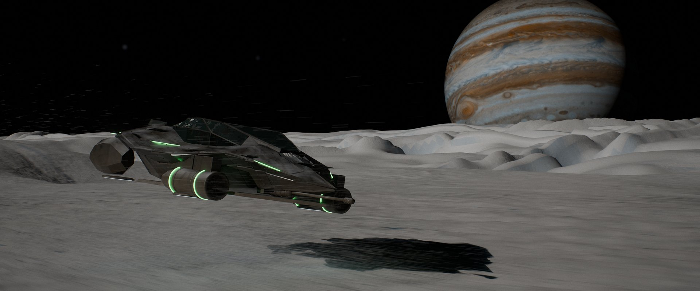
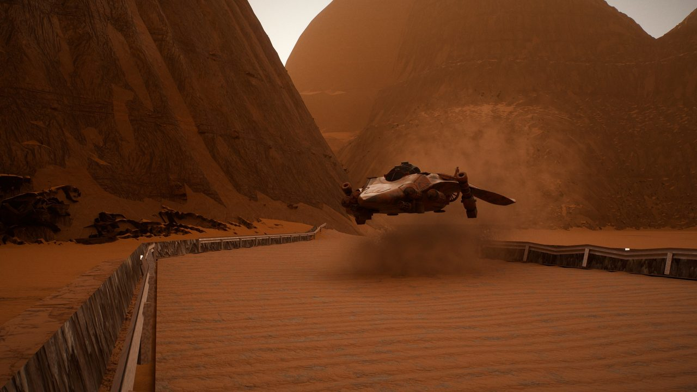
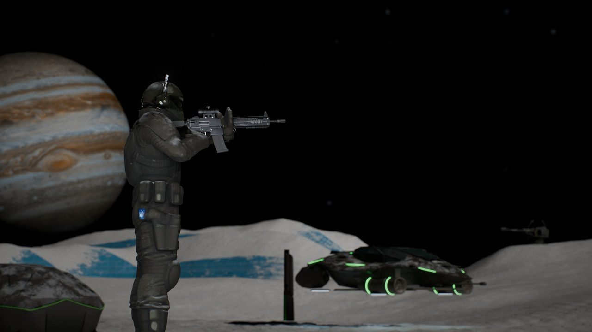
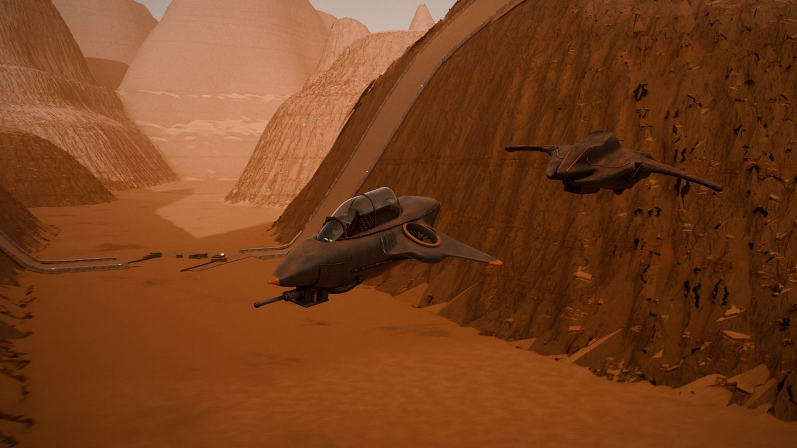
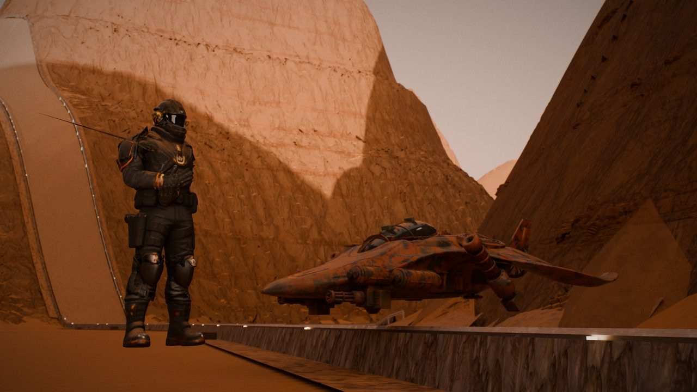

<p align="center">
  
</p>

<p align="center">
  
</p>

<h1 align="center">Direct Order 27</h1>

<p align="center">
  <b>Hover-tank strategy and first-person combat on Europa and Mars.</b><br>
  Command the base from your cockpit, or fly wing for someone who does.
</p>

<p align="center">
  <a href="https://github.com/PiercingXX/Alpha-test-DO27/releases/latest"></a>
  
  
</p>

<p align="center">
  <a href="#linux-arch-cachyos-ubuntu-debian-install-in-3-steps">Install on Linux</a> ·
  <a href="#windows-install-in-3-steps">Install on Windows</a> ·
  <a href="#controls">Controls</a> ·
  <a href="#reporting-problems">Report a problem</a> ·
  <a href="https://github.com/PiercingXX/Alpha-test-DO27/releases/latest">Release notes</a>
</p>

<table>
  <tr>
    <td width="50%"></td>
    <td width="50%"></td>
  </tr>
  <tr>
    <td width="50%"></td>
    <td width="50%"></td>
  </tr>
</table>

<p align="center"><sub>Path-traced stills of the game's own ships, pilots and maps. A PiercingXX game.</sub></p>

---

## Alpha test (v0.0.6)

Thanks for testing! This repository holds the packaged alpha build only. It runs on Linux (Arch, CachyOS, Ubuntu 22.04 or 24.04, or Debian 12 or 13) and on Windows 10 or 11.

What changed in this build, and what is known to be broken, is in the notes of the latest release: **Releases > Latest**.

## Linux (Arch, CachyOS, Ubuntu, Debian): install in 3 steps

1. Open a terminal, paste this line, and press Enter:

   ```
   curl -fsSL https://raw.githubusercontent.com/PiercingXX/Alpha-test-DO27/main/install.sh | bash
   ```

   On Ubuntu or Debian, paste this line instead (they come without `curl`):

   ```
   wget -qO- https://raw.githubusercontent.com/PiercingXX/Alpha-test-DO27/main/install.sh | bash
   ```

2. Wait. It checks your system, picks the package that fits your graphics card (see **Packages** below), installs anything missing (it may ask for your password once), downloads the game (16 to 31 GB depending on the package, in parts; an interrupted download carries on when you run the line again) and checks every part. The first start builds shader caches and shows its progress; that can take several minutes.

3. Play: open **Direct Order 27 (alpha)** from your app menu, or type `do27` in a terminal. The first time, the game asks you to choose your alpha username.

The game updates itself: each time you start it, it checks for a new alpha build and installs it first. An update downloads only the parts that changed (a small patch is a few MB). Running the install line again also updates it.

## Windows: install in 3 steps

1. Open PowerShell: press the Windows key, type `powershell`, and press Enter. Paste this line (right-click pastes), and press Enter:

   ```
   irm https://raw.githubusercontent.com/PiercingXX/Alpha-test-DO27/main/install.ps1 | iex
   ```

2. Wait. It checks your PC (Windows version, graphics card, free space), downloads the game in parts (16 to 31 GB depending on the package; if the download stops, run the same line again and it carries on) and checks the download. It doesn't need administrator rights.

3. Play: open **Direct Order 27 (alpha)** from the Start menu or the shortcut on your desktop, or type `do27` in a new PowerShell window. The first time, the game asks you to choose your alpha username.

The game updates itself: each time you start it, it checks for a new alpha build and installs it first (a window shows the download). An update downloads only the parts that changed. Running the install line again also updates it.

### If Windows warns you about the game

The alpha isn't signed with a certificate yet, so Windows may not know it:

- **A blue box, "Windows protected your PC":** click **More info**, then **Run anyway**. You only see this once.
- **"Smart App Control blocked an app":** Smart App Control has no "run anyway". The installer tells you if it's on. To play, turn it off: Start > **Windows Security** > **App & browser control** > **Smart App Control settings** > **Off**.
- **Your antivirus removes or blocks `do27_launcher.exe`:** allow the folder `%LOCALAPPDATA%\DO27-alpha` in your antivirus, then run the install line again.

## Packages: LOW, HIGH, ULTRA

The installer reads your graphics card's video memory and picks one package. They differ only in texture detail:

| Package | Chosen when | Download | Installed |
| --- | --- | --- | --- |
| LOW | under 10 GB of video memory, or under 12 GB of RAM | about 16 GB | about 21 GB |
| HIGH | 10 GB of video memory or more | about 23 GB | about 28 GB |
| ULTRA | 20 GB of video memory or more | about 31 GB | about 36 GB |

An update keeps the package you have. To choose one yourself, set `DO27_TIER` to `low`, `high` or `ultra` before the install line, for example on Linux: `DO27_TIER=low curl -fsSL https://raw.githubusercontent.com/PiercingXX/Alpha-test-DO27/main/install.sh | bash`. On Windows: `$env:DO27_TIER='low'` in the same PowerShell window first.

## What you need

On Linux:

- Arch Linux or CachyOS (64-bit), updated in the last year (`sudo pacman -Syu`), or Ubuntu 22.04 or 24.04 (64-bit), or Debian 12 or 13 (64-bit)
- On Ubuntu with an NVIDIA card: the NVIDIA driver, installed before the game. Open **Software & Updates > Additional Drivers**, pick the recommended NVIDIA driver, restart, then run the install line. The installer never installs an NVIDIA driver itself. AMD and Intel cards need nothing extra.
- On Debian with an NVIDIA card: enable the `contrib` and `non-free` sources, run `sudo apt install nvidia-driver firmware-misc-nonfree` ([Debian guide](https://wiki.debian.org/NvidiaGraphicsDrivers)), restart, then run the install line.
- On Debian, your account needs `sudo` (if you set a root password during setup, it doesn't have it). The installer tells you the one `su -c` line to run instead if it can't use `sudo`.
- A graphics card with Vulkan: an NVIDIA RTX 2080 or newer, or an AMD RX 6000 or newer
- An NVMe SSD with 25 to 40 GB free, depending on the package (see **Packages**; the installer checks it)
- 16 GB of RAM

On Windows:

- Windows 10 (version 21H2 or newer) or Windows 11, 64-bit
- A graphics card with DirectX 12 and an up-to-date driver: an NVIDIA RTX 2080 or newer, or an AMD RX 6000 or newer
- An SSD with 25 to 40 GB free on the drive Windows is on, depending on the package (see **Packages**; the installer checks it)
- 16 GB of RAM

## Your alpha username

On the first start you choose a username: 3 to 24 letters, digits, `-` or `_`. It is locked for the whole alpha and can't be changed, so pick the name you want to be known by. Names that pose as the dev team (admin, dev, PiercingXX and the like) are refused.

## What gets installed where

On Linux:

- The game: `~/.local/share/do27-alpha/`
- The `do27` and `do27-uninstall` commands: `~/.local/bin/`
- The app-menu entry: `~/.local/share/applications/do27-alpha.desktop`
- Your settings and keys: `~/.config/DO27/`
- Your username, logs and crash reports: `~/.local/share/do27/`
- Graphics caches: `~/.cache/do27/`
- System packages, only if they're missing. Arch and CachyOS: `vulkan-icd-loader`, `vulkan-tools`, your graphics driver (`nvidia-utils`, `vulkan-radeon` or `vulkan-intel`), `curl`, `tar`, `zstd`. Ubuntu and Debian: `libvulkan1`, `mesa-vulkan-drivers`, `vulkan-tools`, `curl`, `tar`, `zstd` and a few standard libraries a desktop already has (sound, X11/Wayland, EGL)

On Windows:

- The game: `%LOCALAPPDATA%\DO27-alpha\` (the `do27` and `do27-uninstall` commands are in its `bin` folder, which the installer adds to your user PATH)
- The Start menu and desktop shortcuts, and an entry in **Settings > Apps > Installed apps**
- Your settings and keys: `%APPDATA%\DO27\`
- Your username, logs and crash reports: `%LOCALAPPDATA%\DO27\`
- Graphics caches: `%LOCALAPPDATA%\DO27\cache\`
- Nothing else: no system files, no drivers, no administrator changes

## Playing together

There is no relay in the alpha: players connect straight to the host. In the game, the host opens **HOST** and **LISTEN**; the lobby shows `LAN IP:7790` for players on the same network. For friends over the internet, the host forwards **UDP 7790** on their router and gives them their public IP with `:7790`. A joiner picks **JOIN HOST BY ADDRESS**, types `IP:7790`, **NEXT**, then **JOIN MATCH**. The full steps are in the testers guide.

The first screen asks for your username and says it plainly: this alpha sends every log (game, engine, match, network, crash, performance), your username and your IP address to the developer automatically. It can't be turned off. Playing means you agree.

## Controls

Every key lives in one file you can edit, `~/.config/DO27/key.map` on Linux or `%APPDATA%\DO27\key.map` on Windows. Each line names its action and says where the default came from. The same bindings are in the game under **Settings > Input**, which writes the same file. The default is built for a Colemak keyboard and has a QWERTY version with the keys in the same places; pick yours on the first start. Menus also take `h` `j` `k` `l`.

## Reporting problems

Crash and session logs are sent to the dev team automatically, so a crash gets reported even if you do nothing: during play, when you quit, and on the next start after a crash. To tell us what happened, open an issue here (**Issues > New issue > Bug report**) or post in the alpha channel on Discord. Include your alpha username and the time it happened.

If we ask for your logs, they are in `~/.local/share/do27/logs/` on Linux and under `%LOCALAPPDATA%\DO27\` on Windows. Zip the newest session folder and send it in the issue or on Discord.

## What the alpha logs

By playing the alpha you agree that these are sent to the dev team with every session and crash, on Linux and on Windows:

- your alpha username
- your IP address
- your system: Linux distribution and kernel, or Windows version and build; processor, graphics card and driver, memory
- the game's and the engine's session logs, crash and freeze reports (on Windows these include a small memory dump of the game's threads when it freezes) and performance numbers

## Uninstall

On Linux:

```
do27-uninstall
```

On Windows: **Settings > Apps > Installed apps > Direct Order 27 (alpha) > Uninstall**, or **Uninstall Direct Order 27 (alpha)** in the Start menu, or type `do27-uninstall` in PowerShell.

This removes the game, the commands, the app-menu or Start menu entries, your settings, logs and caches. Your alpha username stays reserved until the alpha ends. On Linux the system packages stay: they're standard Arch, Ubuntu or Debian packages that other programs use too.

## License and checking your download

This is a test build under the alpha license in [`LICENSE-ALPHA.txt`](LICENSE-ALPHA.txt). It is a personal, revocable license to test; please don't share the build or anything from it. The installer also copies the license into your install folder.

Each release carries `SHA256SUMS-<version>.txt`, the SHA-256 of every file in it, and an OpenTimestamps proof of that list (`.ots`) that dates the release. The installer already checks every part it downloads; you don't need to do anything.
